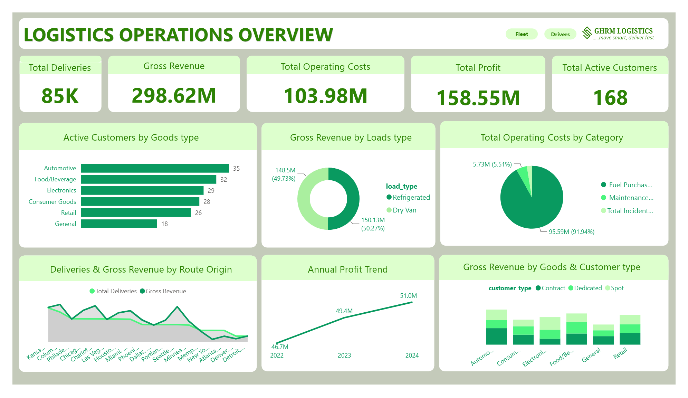
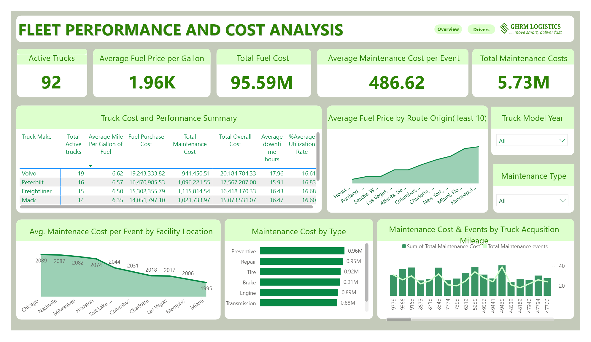
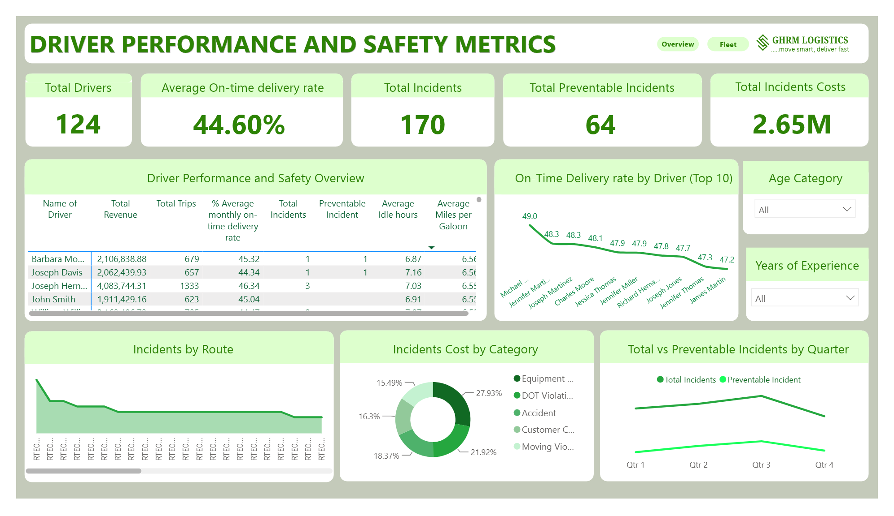

# GHRM Logistics Operations and Performance Analysis

## Project Overview

This project is a logistics data analytics case study developed using Power BI to explore operational performance, fleet efficiency, maintenance costs, delivery performance, and driver safety.

Working with 15 related data tables, I transformed and modelled the data to develop an interactive, multi-page dashboard that provides insights into logistics operations and supports data-driven decision-making.

## Dashboard Preview

### 1. Logistics Operations Overview

### 2. Fleet Performance & Cost Analysis

### 3. Driver Performance & Safety

## Project Files

Explore the interactive Power BI report online or download the file to view and interact with the analysis.

- [View Power BI File Online](https://1drv.ms/u/c/df7f0bbb414726f8/IQDyoHAD3J-hSIGIxQNp4DDGARzz4Z02rbwrjx59yLGYnBM?e=ubac3s)
- [Download Power BI File](https://github.com/chimelumivy/Microsoft-Power-BI-Projects/blob/main/GHRM%20LOGISTICS%20OPERATIONS%20AND%20PERFORMANCE%20ANALYSIS/GHRM-Logistics-Operations-and-Performancr-Analysis.pbix?raw=1)

## Project Objectives

- Evaluate overall logistics operations and financial performance.
- Analyse fleet utilisation, fuel consumption, and maintenance costs.
- Assess delivery performance and driver productivity.
- Examine driver safety records and preventable incidents.
- Identify operational trends and areas requiring improvement.

## Key Dashboard Features

**1. Logistics Operations Overview**
- Key performance indicators for deliveries, gross revenue, operating costs, profit, and active customers.
- Customer distribution by goods type.
- Revenue comparison by load type.
- Operating cost breakdown by category.
- Delivery and revenue trends by route origin.
- Annual profit trends from 2022 to 2024.

**2. Fleet Performance & Cost Analysis**
- Active truck count, average fuel price, total fuel cost, and maintenance cost KPIs.
- Truck performance and cost summary by truck make.
- Fuel price trends by route origin.
- Maintenance cost analysis by facility location and maintenance type.
- Maintenance costs and events by truck acquisition mileage.
- Interactive filters for truck model year and maintenance type.

**3. Driver Performance & Safety**
- Total drivers, average on-time delivery rate, total incidents, preventable incidents, and incident costs.
- Driver performance and safety summary.
- Top 10 drivers by on-time delivery rate.
- Incident distribution by route and incident category.
- Quarterly comparison of total and preventable incidents.
- Interactive filters for driver age category and years of experience.

## Key Insights

- The dashboard recorded **85,000 deliveries**, generating **298.62M in gross revenue** and **158.55M in total profit**.
- Refrigerated loads contributed 150.13M (50.27%) of gross revenue, marginally exceeding Dry Van at 148.50M (49.73%).
- Fuel purchases represented 91.94% of total operating costs, making fuel expenditure a major cost component.
- Annual profit increased from 46.7M in 2022 to 51.0M in 2024.
- The fleet dashboard recorded 92 active trucks, with total fuel costs of 95.59M and total maintenance costs of 5.73M.
- Driver performance analysis recorded an average on-time delivery rate of 44.60%, alongside 170 incidents, of which 64 were preventable.

## Tools and Techniques

- Microsoft Power BI
- Power Query for data transformation and preparation
- Data modelling and relationships
- DAX measures and calculated columns
- Interactive dashboard design and visualisation
- Canva for dashboard design elements

## Conclusion

This project provided an opportunity to explore how data analytics can support logistics operations, cost management, fleet efficiency, and driver safety. By bringing together different operational datasets, the dashboards provide a structured view of business performance and highlight areas that may benefit from further investigation and improvement.

**Thank you for exploring my project!**
