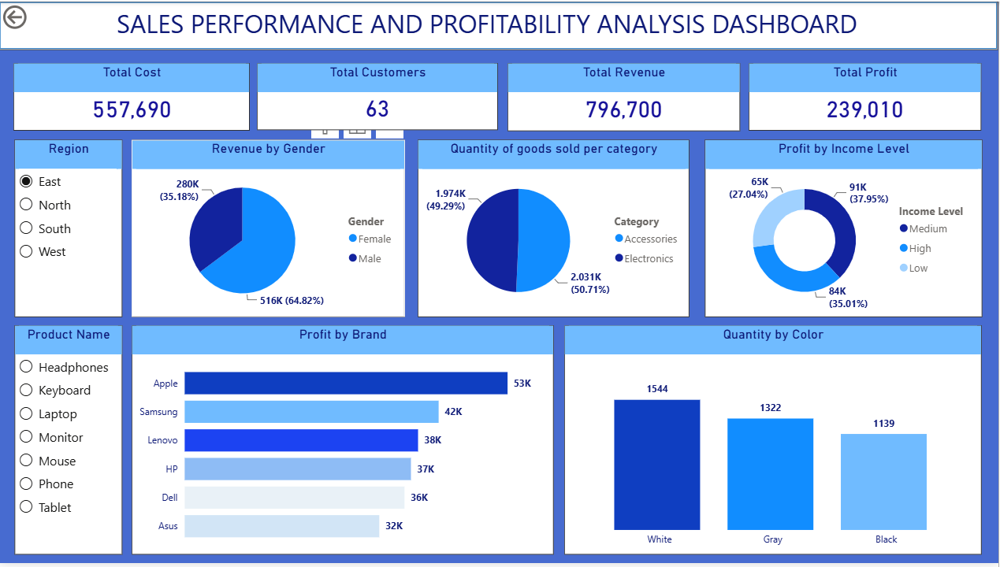

# Sales Performance and Profitability Analysis

## Dashboard Preview

## Project Overview

This project involves the development of an interactive Power BI dashboard to analyse sales performance, revenue, profitability, customer distribution, and product trends.

The dashboard provides a consolidated view of key business performance indicators and enables users to explore sales data across different regions and product categories.

## Project Objectives

- Monitor overall sales performance using key performance indicators.
- Evaluate revenue, costs, and profitability.
- Examine revenue distribution across customer demographics.
- Analyse product category and colour preferences.
- Compare profitability across brands and customer income levels.
- Support data-driven business decisions through interactive visualisations.

## Key Dashboard Features

- **KPI Cards:** Total Cost, Total Customers, Total Revenue, and Total Profit.
- **Revenue by Gender:** Comparison of revenue generated by female and male customers.
- **Quantity Sold by Product Category:** Comparison of quantities sold across product categories.
- **Profit by Income Level:** Analysis of profitability across customer income groups.
- **Profit by Brand:** Ranking of brands based on their contribution to profit.
- **Quantity by Colour:** Comparison of product quantities sold by colour.
- **Interactive Filters:** Region and Product Name slicers for exploring different segments of the sales data.

## Key Insights

- The business recorded **796,700 in total revenue**, **239,010 in total profit**, and **557,690 in total costs**, with 63 customers represented in the dashboard.
- Female customers contributed 516K (64.82%) of revenue, compared with 280K (35.18%) from male customers.
- Accessories accounted for 2.031K units sold (50.71%), slightly exceeding Electronics at 1.974K units (49.29%).
- The Medium income group contributed the highest profit at 91K (37.95%), followed by the High income group at 84K (35.01%) and the Low income group at 65K (27.04%).
- Apple recorded the highest profit among the displayed brands at 53K, followed by Samsung at 42K and Lenovo at 38K.
- White products recorded the highest quantity sold at 1,544 units, followed by Grey at 1,322 and Black at 1,139.

## Tools and Techniques

- Microsoft Power BI
- Power Query for data transformation and preparation
- DAX for calculations and measures
- Data modelling
- Interactive dashboard design and data visualisation

## Conclusion

This project demonstrates how business data can be transformed into meaningful insights through data analysis and visualisation. The dashboard provides an overview of sales performance and profitability while allowing users to explore customer, product, and brand-level trends to support informed business decisions.

**Thank you for exploring my project!**
